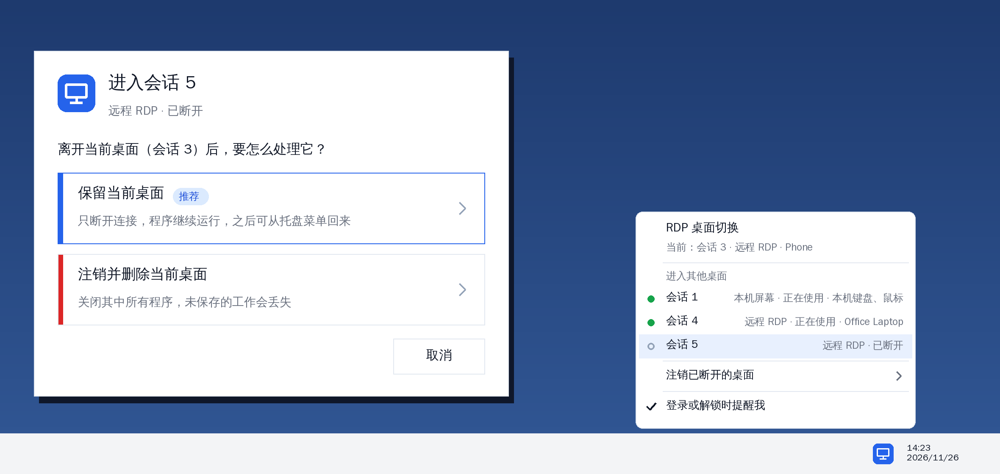

<h1 align="center">RDP Wrapper + Session Picker</h1>

<p align="center"><b>本地与远程桌面会话选择工具</b></p>
<p align="center">登录、解锁或重连后，选择继续使用当前桌面，或接管已有桌面。</p>

<p align="center">
  <b>简体中文</b> · <a href="README_EN.md">English</a>
</p>

<p align="center">
  <a href="https://github.com/XYoung1201/rdpWrapper/releases/latest"><b>下载安装包</b></a> ·
  <a href="#快速上手"><b>快速上手</b></a> ·
  <a href="#功能与操作"><b>功能与操作</b></a> ·
  <a href="#常见问题"><b>常见问题</b></a> ·
  <a href="#反馈与贡献"><b>反馈与贡献</b></a>
</p>

<p align="center">
  <a href="https://github.com/XYoung1201/rdpWrapper/releases/latest"></a>
  
  
  
</p>

<p align="center">
  <a href="session-picker/preview.png"></a>
</p>
<p align="center"><sub>界面使用演示数据，展示本地 HDMI 桌面、正在使用的 RDP 桌面和已断开的桌面。</sub></p>

本仓库基于 sergiye/rdpWrapper，增加了用于 Windows 本地与远程桌面的 Session Picker 配套扩展。上游工具负责配置 RDP Wrapper / TermWrap，选择器负责在登录或解锁后列出当前账户已有的桌面，让用户决定继续使用当前桌面，或接管另一个桌面。

它适合在本机 HDMI 屏幕、另一台电脑和移动端 RDP 客户端之间切换工作位置。选择器采用大字表格、大尺寸按钮和二次确认窗口，同时支持触摸、鼠标与键盘操作。

已在 Windows 11 x64、TermWrap 环境验证本地与 RDP 桌面的双向接管，以及同账户 RDP 会话之间的接管。其他系统与客户端组合需要在目标设备上验证。

## 目录

- [产品特性](#产品特性)
- [适用场景](#适用场景)
- [快速上手](#快速上手)
- [界面导览](#界面导览)
- [功能与操作](#功能与操作)
- [安装与卸载](#安装与卸载)
- [配置说明](#配置说明)
- [常见问题](#常见问题)
- [开发与扩展](#开发与扩展)
- [反馈与贡献](#反馈与贡献)
- [资料与资源](#资料与资源)

## 产品特性

| 特性 | 可以做什么 | 使用效果 |
|---|---|---|
| 本地与 RDP 桌面选择 | 列出同账户的本地屏幕桌面、活动 RDP 桌面与断开的桌面 | 按工作位置和已有内容选择桌面 |
| 登录与解锁触发 | 本地登录、解锁及 RDP 连接、重连后打开窗口 | 在回到桌面时提供选择入口 |
| 大字与大按钮 | 15–19 磅字体、54 像素列表行和大尺寸操作按钮 | 便于在本机显示器与移动端点击、阅读 |
| 分列状态信息 | 展示会话编号、桌面类型、使用状态和连接设备 | 清楚辨认将要接管的桌面 |
| 接管前确认 | 再次说明目标会话、断开连接和注销行为 | 在切换前确认工作已保存 |
| 过渡会话清理 | 接管成功后注销当前过渡会话 | 减少切换后遗留的空闲会话 |
| 后台启动补齐 | 为已存在的会话启动选择器，并检查选择器进程 | 安装前已登录的桌面也能获得选择入口 |

## 适用场景

| 使用需求 | 操作方式 |
|---|---|
| 从手机或另一台电脑继续操作本机桌面 | RDP 登录后选择“本机 HDMI / 屏幕”，确认接管 |
| 回到本机继续使用远程桌面的工作内容 | 解锁本机后选择正在使用的 RDP 桌面 |
| 恢复之前断开的桌面 | 在列表中选择状态为“已断开，可恢复”的会话 |
| 保持当前桌面 | 点击“继续使用当前桌面”，或按 Esc |
| 随时重新选择桌面 | 从开始菜单打开 `RDP Session Picker` |

## 快速上手

### 下载安装

1. 先通过上游 RDP Wrapper / TermWrap 配置好本机远程桌面支持。
2. 下载本仓库发行页中的 `RDP-Session-Picker-v1.0.0.zip`，解压完整文件夹。
3. 在正在使用的桌面中双击 `session-picker/Install.cmd`，确认 UAC 提示。
4. 本地登录、解锁或 RDP 重连后，等待“选择要使用的桌面”窗口出现。
5. 选择一行并点击“接管选中的桌面”，阅读确认内容后执行切换。

接管后，目标桌面的原连接会断开，当前桌面会注销。请先保存当前桌面中的工作。

安装包与上游工具分别提供下载入口。[选择器发行版](https://github.com/XYoung1201/rdpWrapper/releases/latest) · [上游 RDP Wrapper 发行版](https://github.com/sergiye/rdpWrapper/releases)

### 环境要求

| 项目 | 要求与用途 |
|---|---|
| 已验证系统 | Windows 11 x64 |
| 远程桌面服务 | 已配置并能正常连接的 RDP Wrapper / TermWrap 环境 |
| 脚本与界面运行时 | Windows PowerShell 5.1、.NET Framework、Windows Forms |
| 安装与卸载 | 管理员确认，用于部署系统任务和设置 |
| 日常使用 | 选择器以会话用户的普通权限运行，列出同一账户的桌面 |

### 从源码安装

```powershell
git clone https://github.com/XYoung1201/rdpWrapper.git
cd rdpWrapper
.\session-picker\Install.cmd
```

UAC 提示会出现在启动安装程序的会话中。通过 RDP 使用时，请在对应的远程桌面中启动安装程序。

## 界面导览

| 位置 | 主要内容 |
|---|---|
| 顶部 | 当前会话编号与登录账户 |
| 桌面列表 | 会话编号、桌面类型、使用状态与客户端设备名称 |
| 状态提示 | 说明接管后的连接与注销行为，或提示没有其他桌面 |
| 左下按钮 | 继续使用当前桌面 |
| 右下按钮 | 接管选中的桌面，选择一行后启用 |
| 确认窗口 | 再次显示目标会话和当前桌面的注销提示 |

## 功能与操作

### 选择与接管桌面

点击列表中的一行，再点击“接管选中的桌面”。目标会话会在执行前重新核验，确认属于当前账户且仍可使用后才尝试连接。

本地屏幕与 RDP 桌面都以 Windows 会话呈现。Windows 的任务视图虚拟桌面属于各自会话内部，多个虚拟桌面会显示为同一个会话条目。

### 常用操作与快捷键

| 操作 | 方式 |
|---|---|
| 选择桌面 | 触摸、鼠标点击，或在列表中使用方向键 |
| 在控件间移动 | Tab |
| 接管选中的桌面 | 在列表中按 Enter，或点击接管按钮 |
| 保留当前桌面 | 点击继续按钮、关闭窗口，或按 Esc |
| 返回选择 | 在接管确认窗口点击“返回选择”或按 Esc |

### 当前功能边界

选择器在 Windows 完成登录或解锁后显示。连接过程中，Windows 可能已经恢复旧会话。登录前强制创建全新独立会话的功能尚未实现。

列表在窗口打开时读取，目标状态在接管前再次核验。需要查看后续新增的会话时，可关闭窗口并从开始菜单重新打开。

## 安装与卸载

| 入口 | 作用 |
|---|---|
| `session-picker/Install.cmd` | 安装或更新选择器，并启动后台任务 |
| `session-picker/Uninstall.cmd` | 移除选择器任务、进程、开始菜单入口和运行文件，恢复保存的单会话设置 |
| 开始菜单中的 `RDP Session Picker` | 手动打开桌面选择器 |

卸载后保留本地运行历史，可按需删除。完整脚本说明见[选择器文档](session-picker/README.md)。

## 配置说明

| 位置 / 配置 | 作用 |
|---|---|
| `%ProgramFiles%\RdpSessionPicker` | 已安装的运行文件 |
| 系统任务 `RdpSessionPickerBroker` | 开机运行，以 SYSTEM 身份为各会话启动普通权限的选择器 |
| `fSingleSessionPerUser` | 安装时将系统与策略中的值设为 `0`，允许同账户多会话 |
| `settings-before-install.json` | 保存首次安装时的单会话设置，用于卸载恢复 |
| `%LocalAppData%\RdpSessionPicker\history.log` | 窗口显示与会话切换记录 |
| `%ProgramData%\RdpSessionPicker\broker.log` | 后台任务启动与错误记录 |

后台任务每五秒检查一次选择器进程，连接和解锁由 Windows WTS 事件触发。

## 常见问题

| 现象 | 检查与处理 |
|---|---|
| RDP 重连后没有弹窗 | 确认已安装新版，检查后台任务和 `broker.log`；可先从开始菜单手动打开 |
| HDMI 屏幕解锁后没有弹窗 | 确认版本包含本地连接和解锁事件处理，再检查对应会话中的选择器进程 |
| 看不到其他桌面 | 当前列表只提供同一账户的其他 Windows 会话；核对账户、会话状态与实际安装版本 |
| 看不到任务视图中的多个虚拟桌面 | 虚拟桌面归属同一 Windows 会话，列表按会话显示 |
| 同账户连接后直接恢复了旧桌面 | Windows 已完成恢复；选择器会在进入桌面后提供已有会话选择 |
| 没看到 UAC 提示 | 查看启动安装程序的桌面；RDP 安装应从远程桌面内启动 |
| 接管时目标状态发生变化 | 关闭窗口后重新打开，重新选择仍然存在的目标会话 |
| 切换失败并显示错误码 | 保留错误码、系统版本、会话状态与相关日志，用于复现和排查 |

## 开发与扩展

### 工程结构

| 路径 | 职责 |
|---|---|
| `rdpWrapper/`、`rdpWrapper.sln` | 上游 RDP Wrapper 的 C# 工程 |
| `session-picker/SessionPicker.ps1` | 选择器运行与事件循环 |
| `session-picker/PickerUI.ps1` | 大字界面、接管确认与切换操作 |
| `session-picker/Native.cs` | WTS 会话查询、连接与注销接口 |
| `session-picker/Watcher.cs` | 本地连接、RDP 连接与解锁通知 |
| `session-picker/Broker.ps1`、`BrokerNative.cs` | 后台进程补齐与用户会话内启动 |
| `session-picker/Install.ps1`、`Uninstall.ps1` | 安装、设置保存与卸载恢复 |
| `session-picker/tests/` | 事件与界面检查 |

### 验证命令

在仓库根目录运行。

```powershell
powershell.exe -NoProfile -ExecutionPolicy Bypass -STA -File session-picker\tests\Test-Events.ps1
powershell.exe -NoProfile -ExecutionPolicy Bypass -STA -File session-picker\tests\Test-UI.ps1
```

事件检查覆盖本地连接、远程连接、解锁和锁屏的处理。界面检查使用演示数据验证条目、字体、按钮、行选择和确认取消。实际网络连接与接管需要在目标设备上验证。

上游 C# 工程通过 `make.bat` 调用 Visual Studio MSBuild 进行还原与构建，相关工具功能与使用说明见上游项目。

## 反馈与贡献

欢迎通过本仓库的 Pull Request 改进代码或文档。复现说明应包含系统与客户端版本、选择器版本、最短操作步骤、预期结果和实际结果。提供日志或截图前，请移除账户、设备和网络信息。[提交 Pull Request](https://github.com/XYoung1201/rdpWrapper/pulls)

RDP Wrapper 核心与 TermWrap 相关问题可结合上游说明排查。[上游问题列表](https://github.com/sergiye/rdpWrapper/issues)

## 资料与资源

- [选择器详细文档](session-picker/README.md)
- [选择器发行版与安装包](https://github.com/XYoung1201/rdpWrapper/releases)
- [上游 sergiye/rdpWrapper](https://github.com/sergiye/rdpWrapper)
- [TermWrap](https://github.com/llccd/TermWrap)
- [RDPWrapOffsetFinder](https://github.com/llccd/RDPWrapOffsetFinder)
- [Windows WTS 会话事件](https://learn.microsoft.com/en-us/windows/win32/termserv/wm-wtssession-change)
