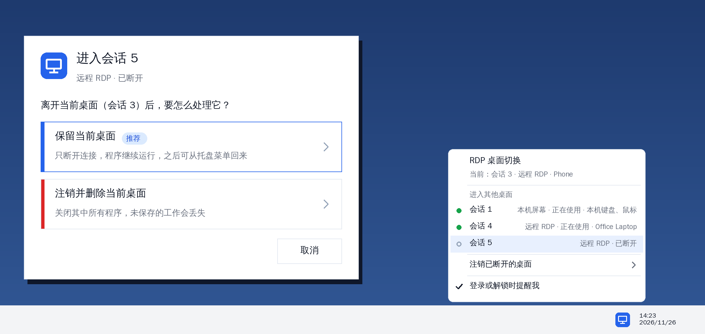

<h1 align="center">RDP Wrapper + Session Picker</h1>

<p align="center"><b>Choose between local and remote Windows desktops</b></p>
<p align="center">A tray icon that stays in the notification area: right-click to enter another desktop, then keep or log off the one you leave.</p>

<p align="center">
  <a href="README.md">简体中文</a> · <b>English</b>
</p>

<p align="center">
  <a href="https://github.com/XYoung1201/rdpWrapper/releases/latest"><b>Download</b></a> ·
  <a href="#quick-start"><b>Quick start</b></a> ·
  <a href="#using-the-picker"><b>Usage</b></a> ·
  <a href="#frequently-asked-questions"><b>FAQ</b></a> ·
  <a href="#feedback-and-contributions"><b>Contribute</b></a>
</p>

<p align="center">
  <a href="https://github.com/XYoung1201/rdpWrapper/releases/latest"></a>
  
  
  
</p>

<p align="center">
  <a href="session-picker/preview.png"></a>
</p>
<p align="center"><sub>Design mockup with demo data: the tray menu (right) and the prompt shown when entering a desktop (left). The interface is in Chinese.</sub></p>

This fork of sergiye/rdpWrapper adds Session Picker, a companion for choosing existing Windows desktops. The upstream application configures RDP Wrapper / TermWrap. The picker runs as a tray icon in every session; its menu lists the other desktops belonging to the signed-in account.

Use it when moving between a local HDMI display, another computer, and a mobile RDP client. When you enter another desktop, a prompt asks whether to keep the current desktop (disconnect only) or log it off.

Local-to-RDP, RDP-to-local, and same-account RDP session takeover have been verified on Windows 11 x64 with TermWrap. Other systems and client combinations require testing on the target device.

## Contents

- [Features](#features)
- [Quick start](#quick-start)
- [Interface guide](#interface-guide)
- [Using the picker](#using-the-picker)
- [Installation and removal](#installation-and-removal)
- [Configuration](#configuration)
- [Frequently asked questions](#frequently-asked-questions)
- [Development](#development)
- [Feedback and contributions](#feedback-and-contributions)
- [Resources](#resources)

## Features

| Feature | Behavior |
|---|---|
| Local and remote desktops | Lists local console, active RDP, and disconnected sessions owned by the current account |
| Tray icon | Stays in the notification area; right- or left-click opens the desktop menu |
| Sign-in reminder | After local sign-in, unlock, RDP connection, and reconnection, shows a notification when other desktops exist (can be turned off) |
| Keep or log off | Entering another desktop asks whether to keep the current one (disconnect) or log it off |
| Session details | Shows the session ID, desktop type, status, and client device |
| Cleanup | A submenu logs off disconnected desktops you kept earlier |
| Background startup | Starts pickers in existing sessions and restores missing picker processes |

## Quick start

1. Configure a working RDP host using the upstream RDP Wrapper / TermWrap tools.
2. Download `RDP-Session-Picker-v1.0.0.zip` from this fork's releases and extract the complete folder.
3. Run `session-picker/Install.cmd` from the desktop you are using and accept its UAC prompt.
4. A blue monitor icon appears in the notification area. Right-click it, pick a desktop, then choose to keep or log off the current desktop.

Entering a desktop disconnects its previous connection. If you choose to log off the current desktop, unsaved work in it is lost.

The picker package and upstream application have separate download pages. [Picker releases](https://github.com/XYoung1201/rdpWrapper/releases/latest) · [Upstream application releases](https://github.com/sergiye/rdpWrapper/releases)

### Requirements

| Component | Requirement |
|---|---|
| Verified system | Windows 11 x64 |
| RDP host | Working RDP Wrapper / TermWrap configuration |
| Runtime | Windows PowerShell 5.1, .NET Framework, and Windows Forms |
| Installation / removal | Administrator approval for system settings and the scheduled task |
| Daily operation | Picker processes run as the session user and offer that account's desktops |

### Install from source

```powershell
git clone https://github.com/XYoung1201/rdpWrapper.git
cd rdpWrapper
.\session-picker\Install.cmd
```

Start installation inside the desktop where you can approve UAC. When using RDP, launch the installer from that remote desktop.

## Interface guide

| Area | Content |
|---|---|
| Tray icon | Always visible; hover shows the current session ID |
| Menu header | Current session ID, desktop type, and device |
| Enter another desktop | One row per same-account session: green dot = in use, hollow dot = disconnected, with type, state, and device on the right |
| Log off disconnected desktops | Submenu with a confirmation for each disconnected session |
| Remind me at sign-in or unlock | Toggles the notification |
| Enter prompt | Two large cards, "Keep current desktop" (default) and "Log off and delete current desktop", plus Cancel |

## Using the picker

Right- or left-click the tray icon (or click the reminder notification, or open `RDP Session Picker` from the Start menu) and pick a desktop. In the prompt, choose Keep (disconnects the current desktop; programs keep running and you can come back from the menu) or Log off (closes everything in the current desktop). Esc or Cancel does nothing.

The picker shows Windows user sessions. Task View virtual desktops within one session share a single entry. The list is read each time the menu opens and checked again before switching. The broker restarts the tray process within seconds if it exits, so the menu has no Exit item.

The tray icon appears after Windows completes sign-in. Windows may already have restored an existing session. Forcing a brand-new independent session before sign-in is not implemented.

## Installation and removal

Run `session-picker/Install.cmd` to install or update. The `RDP Session Picker` Start menu entry opens the tray menu.

Run `session-picker/Uninstall.cmd` to remove the task, picker processes, shortcut, and runtime files, and restore the saved single-session settings. Local history remains available for manual removal. Additional details are in the [companion documentation in Chinese](session-picker/README.md).

## Configuration

| Location / setting | Purpose |
|---|---|
| `%ProgramFiles%\RdpSessionPicker` | Installed runtime files |
| `RdpSessionPickerBroker` task | Starts at boot as SYSTEM and launches ordinary user-level picker processes in each session |
| `fSingleSessionPerUser` | Set to `0` in the system and policy locations during installation |
| `settings-before-install.json` | First-install settings snapshot used by the uninstaller |
| `%LocalAppData%\RdpSessionPicker\history.log` | Reminder and switching history |
| `%LocalAppData%\RdpSessionPicker\settings.json` | Whether to show the sign-in reminder |
| `%ProgramData%\RdpSessionPicker\broker.log` | Broker startup and error log |

The broker checks picker processes every five seconds. WTS notifications trigger connection and unlock handling.

## Frequently asked questions

| Symptom | Check |
|---|---|
| No tray icon | Check the hidden-icons overflow, the installed version, the broker task, and the broker log |
| No reminder after reconnect or unlock | Reminders only appear when other desktops exist; check the menu toggle and Windows notification settings |
| Another desktop is missing | Check the account, Windows session state, and installed version |
| Task View desktops are missing | Multiple virtual desktops in one Windows session share one picker entry |
| RDP restores an old desktop directly | Windows has restored that session before the picker opens |
| UAC is not visible | Check the desktop that launched the installer |
| Destination state changed | Reopen the picker and choose a session that is still available |
| Takeover returns an error | Record the error code, system and client versions, session state, and relevant logs |

## Development

The upstream C# application is in `rdpWrapper/`, with `rdpWrapper.sln` and the Visual Studio MSBuild-based `make.bat` at the repository root.

| Companion file | Responsibility |
|---|---|
| `session-picker/SessionPicker.ps1` | Tray runtime and event loop |
| `session-picker/PickerUI.ps1` | Tray icon, menu, enter prompt, and switching |
| `session-picker/Native.cs` | WTS query, connection, and logoff APIs |
| `session-picker/Watcher.cs` | Local, remote, and unlock notifications |
| `session-picker/Broker.ps1`, `BrokerNative.cs` | Per-session startup and process recovery |
| `session-picker/Install.ps1`, `Uninstall.ps1` | Deployment and settings restoration |

Run these checks from the repository root.

```powershell
powershell.exe -NoProfile -ExecutionPolicy Bypass -STA -File session-picker\tests\Test-Events.ps1
powershell.exe -NoProfile -ExecutionPolicy Bypass -STA -File session-picker\tests\Test-UI.ps1
```

The checks cover event handling and demo-data UI behavior, including confirmation cancellation. Verify actual network connections and takeovers on the target device.

## Feedback and contributions

Contribute code, documentation, or reproducible fixes through this fork's pull requests. Include system and client versions, picker version, minimal steps, and expected and actual behavior. Remove account, device, and network details before sharing logs or screenshots. [Pull requests](https://github.com/XYoung1201/rdpWrapper/pulls)

For the RDP Wrapper core and TermWrap, consult the upstream documentation and issue tracker. [Upstream issues](https://github.com/sergiye/rdpWrapper/issues)

## Resources

- [Detailed picker documentation in Chinese](session-picker/README.md)
- [Picker releases](https://github.com/XYoung1201/rdpWrapper/releases)
- [Upstream sergiye/rdpWrapper](https://github.com/sergiye/rdpWrapper)
- [TermWrap](https://github.com/llccd/TermWrap)
- [RDPWrapOffsetFinder](https://github.com/llccd/RDPWrapOffsetFinder)
- [Windows WTS session notifications](https://learn.microsoft.com/en-us/windows/win32/termserv/wm-wtssession-change)
