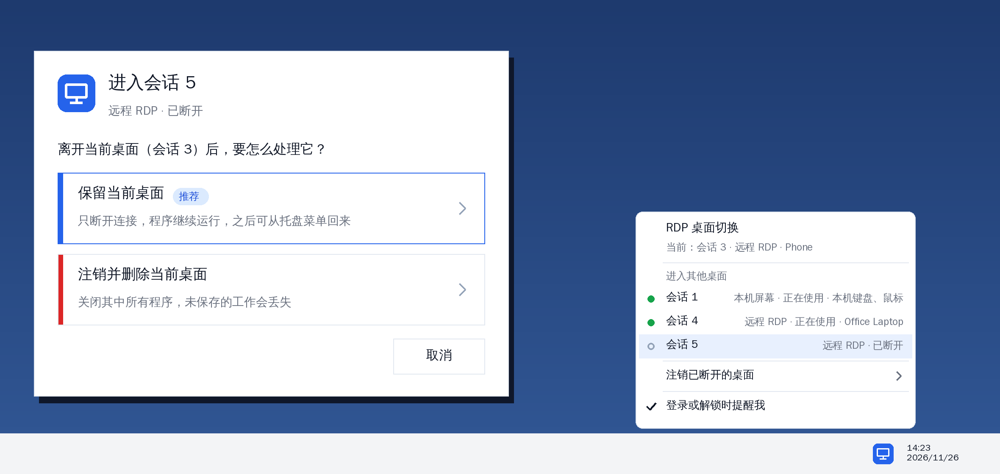

# RDP Session Picker · 桌面会话选择器

System tray switcher for local console and RDP sessions belonging to the signed-in account. A companion for RDP Wrapper / TermWrap: the tray icon stays in the notification area, its menu lists the other desktops, and entering one asks whether to keep or log off the desktop you leave.

右下角托盘图标常驻，右键选择同一账户已有的本地 / RDP 桌面进入，进入时选择保留还是注销当前桌面。



## 功能

- 托盘图标常驻右下角，右键或左键打开桌面菜单，不再弹出大窗口。
- 菜单列出同账户正在使用（实心绿点）和已经断开（空心圆点）的本地 / RDP 桌面，右侧显示类型、状态和设备。
- 进入其他桌面时弹出提示窗口：“保留当前桌面”（默认，只断开）或“注销并删除当前桌面”。
- “注销已断开的桌面”子菜单用于清理之前保留的桌面。
- “启用多桌面”开关：关闭后新的远程连接直接进入已有桌面，不再新建桌面。
- “设备绑定”子菜单（需启用多桌面）：把某台远程设备（按 RDP 客户端名称识别）固定到某个桌面，它每次新连接都直接进入该桌面。
- 本地 HDMI 屏幕登录 / 解锁、RDP 连接 / 重连后，如果有其他桌面，弹出一条通知提醒，可在菜单中关闭。
- 支持触摸、鼠标、方向键、Tab、Enter 和 Esc。
- 后台任务为安装前已经存在的会话启动托盘程序，并补齐退出的进程。

## 安装

1. 先使用 RDP Wrapper / TermWrap 配置好远程桌面服务。
2. 下载本目录或发行包，并解压完整文件夹。
3. 在正在使用的本地或 RDP 桌面中双击 `Install.cmd`，确认 UAC 提示。
4. 右下角会出现蓝色显示器图标。从开始菜单打开 `RDP Session Picker` 也会弹出它的菜单。

本扩展使用 Windows PowerShell 5.1、.NET Framework 和 Windows 自带的 WTS 接口。已在 Windows 11 x64、TermWrap 环境验证同账户并发、本地与 RDP 之间双向接管，以及 RDP 会话接管。其他系统版本的兼容性需要单独验证。

安装位置为 `%ProgramFiles%\RdpSessionPicker`。安装器将系统和策略中的 `fSingleSessionPerUser` 设为 `0`，并保存首次安装时的值。

系统任务 `RdpSessionPickerBroker` 在开机时启动，以 SYSTEM 身份为各用户自己的会话启动普通权限的托盘程序。菜单只提供当前账户的桌面。任务每五秒检查一次托盘进程，所以托盘程序退出后会自动重新启动，菜单中也就没有“退出”项。解锁与连接由 WTS 事件触发。

## 使用

右键托盘图标，点击要进入的桌面，然后在提示窗口中选择：

- **保留当前桌面**（默认）：当前桌面只断开连接，程序继续运行，之后可从托盘菜单回来。
- **注销并删除当前桌面**：关闭当前桌面中的所有程序并注销，未保存的工作会丢失。
- **取消** 或按 Esc：什么都不做。

进入后，目标桌面原来的连接会断开。如果目标桌面正在另一台设备上使用，提示窗口会额外说明。

### 多桌面开关与设备绑定

“启用多桌面”写入 `%ProgramData%\RdpSessionPicker\shared\config.json`，后台任务每秒读取并把系统和策略中的 `fSingleSessionPerUser` 设为 `0`（开启）或 `1`（关闭）。设置只影响之后的新连接，已打开的桌面保留。

“设备绑定”同样保存在该文件中。后台任务发现某台已绑定设备产生新的 RDP 连接时，用 `WTSConnectSession` 把连接移入绑定的会话：为这次连接新建的空桌面随即注销，被 Windows 恢复的旧桌面只断开。绑定的会话已不存在时，这台设备下次打开的新桌面成为新的绑定目标。托盘菜单中的手动切换会留下 30 秒的标记，不会被绑定拉回。

安装器给已登录用户（`S-1-5-11`）授予 `shared` 目录的修改权限，所以同一台电脑上的其他账户也能修改多桌面开关；绑定只会把某个账户的连接移入该账户自己的桌面。

界面显示的是 Windows 用户会话。同一会话中的多个虚拟桌面属于同一个条目。菜单每次打开时重新读取列表，目标状态会在进入前再次核验。

托盘图标在 Windows 完成登录后出现。Windows 可能已经恢复旧会话。登录前强制创建全新独立会话的功能尚未实现。

## 卸载

双击 `Uninstall.cmd` 并确认 UAC。卸载器移除选择器的系统任务、进程、开始菜单入口和运行文件，并恢复保存的单会话设置。

托盘程序日志位于 `%LocalAppData%\RdpSessionPicker\history.log`，提醒开关保存在同目录的 `settings.json`，后台任务日志位于 `%ProgramData%\RdpSessionPicker\broker.log`，多桌面开关与设备绑定保存在 `%ProgramData%\RdpSessionPicker\shared\config.json`。这些历史记录在卸载后保留，可按需删除。

## 验证

在本目录运行下面的命令。

```powershell
powershell.exe -NoProfile -ExecutionPolicy Bypass -STA -File tests\Test-Events.ps1
powershell.exe -NoProfile -ExecutionPolicy Bypass -STA -File tests\Test-UI.ps1
```

事件检查覆盖本地连接、远程连接、解锁和锁屏事件的处理。界面检查使用演示会话，核对托盘菜单条目（不含其他账户）、清理子菜单、多桌面开关、设备绑定的保存与解除、空列表提示，以及进入提示窗口的默认选项、两个选项的返回值、正在使用时的警告和取消行为。加 `-PreviewPath dialog.png -MenuPreviewPath menu.png` 可保存实际渲染截图。实际网络连接与登录仍需要在目标设备上验证。

## 与上游项目的关系

这是基于 sergiye/rdpWrapper 的 fork 中新增的配套扩展。上游工具负责配置远程桌面支持，本目录负责登录后的桌面选择。上游项目介绍见仓库根目录的 README。
